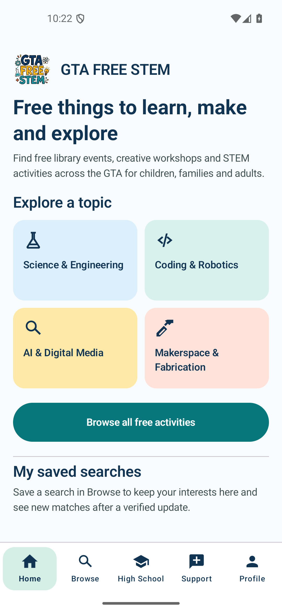
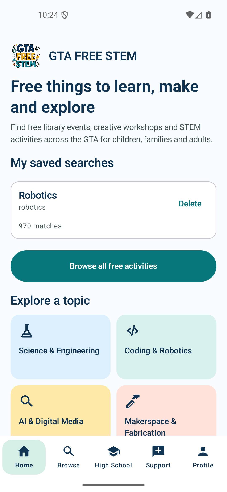

# GTA FREE STEM for Android

I'm building GTA FREE STEM to make free STEM programs easier to find across the Greater Toronto Area. This is the native Android app, built with Kotlin and Jetpack Compose.

[iOS app](https://github.com/rupayon123/gta-free-stem-ios) · [Web app](https://github.com/rupayon123/gta-free-stem-opportunities) · [Try the website](https://gta-free-stem.pages.dev/)

## Landing Home in development

> Development **1.1.1 / build6 is not uploaded**. The existing internal Play release remains version1.1.0/code5.

<table>
<tr><th width="50%">Explore topics</th><th width="50%">Return to a saved search</th></tr>
<tr><td align="center"><a href="docs/showcase/2026-10-28/home-exact-apk-light.png"></a></td><td align="center"><a href="docs/showcase/2026-10-28/home-exact-apk-saved.png"></a></td></tr>
</table>

Actual API36 emulator captures from installed source `e9a8c95f95db62ca6fd542d45d7532ad85f61896`. Home introduces topics; Browse keeps search and filters. Save independent named searches for different ages or interests and return for real matching-event updates. Searches stay on the device and do not automatically enable notifications. [Browse capture](docs/showcase/2026-10-28/browse-exact-apk.png) · [Source and image provenance](docs/showcase/2026-10-28/capture-receipt.json).

The source passed244 unit tests and66 emulator tests. Wider general-library catalogue adoption, full-description translation, API26/physical-device checks and the new signed release remain unfinished. These are development previews, not proof of a newly available Play build.

<details>
<summary>Historical October25 API26 development screenshots</summary>

<table>
  <tr><th width="50%">Home with current feed</th><th width="50%">Search and filters</th></tr>
  <tr>
    <td align="center"><a href="docs/showcase/android-home-api26-2026-10-25.png"></a></td>
    <td align="center"><a href="docs/showcase/android-opportunities-api26-2026-10-25.png"></a></td>
  </tr>
  <tr><th>Activity detail</th><th>What to check</th></tr>
  <tr>
    <td align="center"><a href="docs/showcase/android-detail-api26-2026-10-25.png"></a></td>
    <td>Read the age, date, place, and provider details. Follow the original provider link to confirm availability and registration.</td>
  </tr>
</table>

These are unretouched **API 26 Android emulator** captures of an installed development APK from October 25, 2026. They use a public live feed and are neither Google Play screenshots nor physical-device signoff. Listing counts and dates change. [Capture provenance](docs/showcase/README.md).


</details>

## Find and save an activity

1. Tap **Browse**, choose a topic on Home, or open a saved search. Enter an interest, library, or city; open **Filters** to narrow by age, category, and place.
2. Choose **List** or **Map** when location data is available. Open a result to read its schedule, age range, location, and original provider.
3. Follow the provider link to confirm availability and any registration requirements. Save an activity for later, or use **Save search** in Browse to keep the current criteria under a name. Multiple saved searches can use different ages and interests; editing one requires an explicit update.
4. Use **High School** to explore volunteer hours, co-op, SHSM, and mentorship. If the feed is offline, check the last-checked date and refresh when connected.

## About the app

Search programs by location, age, category, and language. The High School section focuses on volunteer hours, co-op, SHSM, and mentorship. Saved opportunities, profile preferences, and optional new-match alerts stay on your device.

There's no account to create, and no ads or analytics. Nearby search uses an approximate location only when you ask for it. Program links open the provider's website.

## Development status

I'm working on version 1.1.0. It isn't a public Google Play release. Version 1.0.1 was made available to internal testers only.

The screenshots show an installed development APK at a recorded source revision. They do not establish that the current GitHub head builds or that the app is ready for Google Play. Check the linked CI and release checklist for current status.

[Build status](https://github.com/rupayon123/gta-free-stem-android/actions) · [Release notes and checklist](docs/ANDROID_RELEASE_RUNBOOK.md) · [Previous verification records](verification/V1.1.0-LOCAL-VERIFICATION.md)

## Run locally

You'll need Android Studio, Android SDK 36, and Java 17. The app supports Android 8.0 and newer.

1. Open this repository in Android Studio.
2. Let Android Studio configure the SDK location in `local.properties`.
3. Run the `app` configuration on an emulator or Android device.

To run the unit tests, lint, and debug build:

```bash
./gradlew --no-daemon testDebugUnitTest lintDebug assembleDebug
```

Debug builds aren't Google Play upload artifacts. Signing files and passwords belong outside this repository.

## Contributing

This is my personal project, separate from my work at SARIT. Help with accessibility, translations, device testing, and bug fixes is welcome.

- [Contributing](CONTRIBUTING.md)
- [Localization](docs/LOCALIZATION.md)
- [Code of conduct](CODE_OF_CONDUCT.md)
- [Security](SECURITY.md)
- [Privacy and data safety](docs/PRIVACY_AND_DATA_SAFETY_DRAFT.md)

## License

[MIT](LICENSE) for the app's source and documentation. Program descriptions and third-party names and materials belong to their respective owners.
