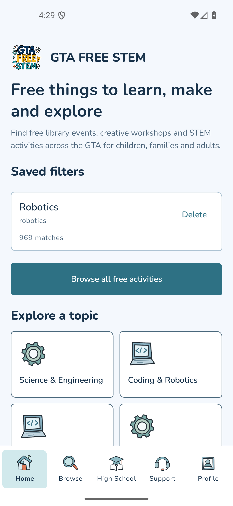
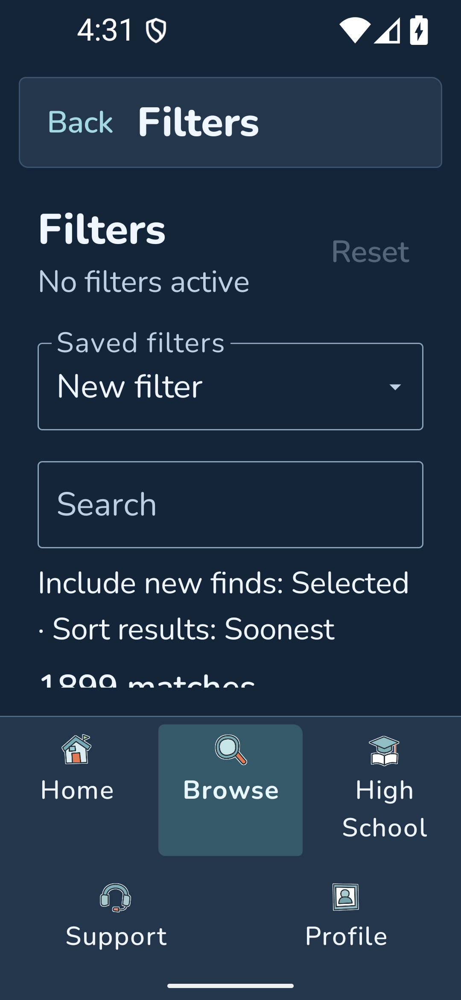
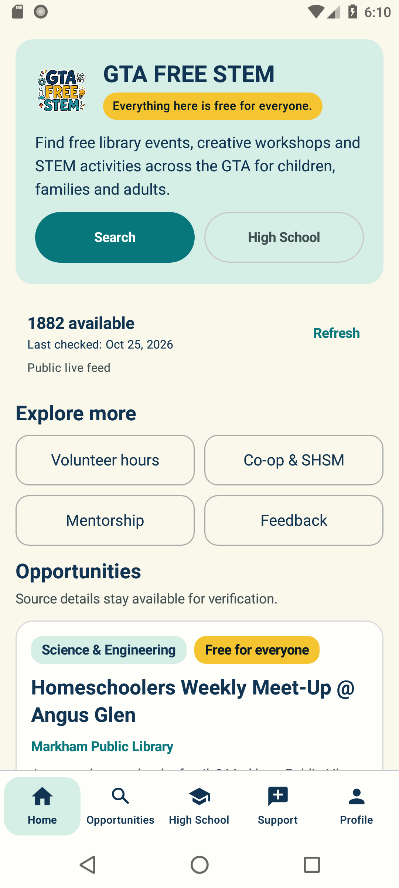
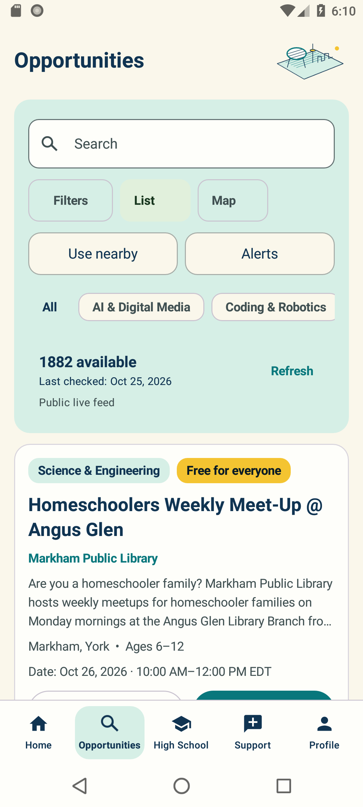
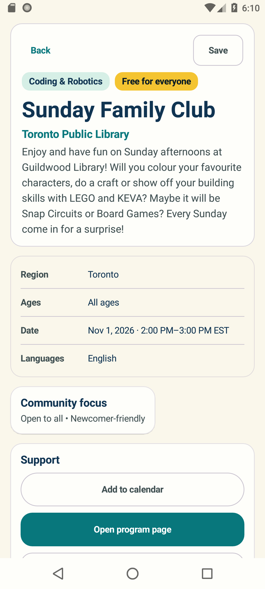

# GTA FREE STEM for Android

I'm building GTA FREE STEM to make free STEM programs easier to find across the Greater Toronto Area. This is the native Android app, built with Kotlin and Jetpack Compose.

[iOS app](https://github.com/rupayon123/gta-free-stem-ios) · [Web app](https://github.com/rupayon123/gta-free-stem-opportunities) · [Try the website](https://gta-free-stem.pages.dev/)

## Home and saved filters

**Version 1.1.1 / build 6 is available to the existing internal testers (October 29, 2026).** This is an internal testing release; public Google Play distribution and physical-phone acceptance remain separate milestones.

<table>
<tr><th width="50%">A landing page for every age</th><th width="50%">Named filters and live results</th></tr>
<tr><td align="center"></td><td align="center"></td></tr>
</table>

Home introduces topics and saved filters. Browse contains search, map/list views and a Filters panel. Choose a named filter inside that panel to apply its query, age and location criteria immediately; matching results update there. **Save filter** creates a named preset, and **Update filter** explicitly saves edits. Different presets can cover different children, ages and interests. Data stays on the device; saving does not automatically enable notifications.

These are unretouched API 36 emulator captures of the production UI used by build 6, not photographs of an owner's phone. [Screenshot provenance](docs/showcase/2026-10-29/capture-receipt.json). Nunito, original light/dark illustrations and the existing GTA logo/loader are included.

Validation: 246 unit tests, release lint, focused API 26/36 navigation/artwork/filter checks and six main-activity cases on each platform passed. Maximum text, RTL, keyboard visibility and reduced-motion behavior were checked. [Current CI](https://github.com/rupayon123/gta-free-stem-android/actions). Physical-phone acceptance, wider catalogue adoption and full-description translations remain open.

<details>
<summary>Historical October25 API26 development screenshots</summary>

<table>
  <tr><th width="50%">Home with current feed</th><th width="50%">Search and filters</th></tr>
  <tr>
    <td align="center"><a href="docs/showcase/android-home-api26-2026-10-25.png"></a></td>
    <td align="center"><a href="docs/showcase/android-opportunities-api26-2026-10-25.png"></a></td>
  </tr>
  <tr><th>Activity detail</th><th>What to check</th></tr>
  <tr>
    <td align="center"><a href="docs/showcase/android-detail-api26-2026-10-25.png"></a></td>
    <td>Read the age, date, place, and provider details. Follow the original provider link to confirm availability and registration.</td>
  </tr>
</table>

These are unretouched **API 26 Android emulator** captures of an installed development APK from October 25, 2026. They use a public live feed and are neither Google Play screenshots nor physical-device signoff. Listing counts and dates change. [Capture provenance](docs/showcase/README.md).


</details>

## Find and save an activity

1. Tap **Browse**, choose a topic on Home, or open a saved filter. Enter an interest, library, or city; open **Filters** to narrow by age, category, and place.
2. Choose **List** or **Map** when location data is available. Open a result to read its schedule, age range, location, and original provider.
3. Follow the provider link to confirm availability and any registration requirements. Save an activity for later, or use **Save filter** inside Filters to keep the current criteria under a name. Multiple saved filters can use different ages and interests; editing one requires an explicit update.
4. Use **High School** to explore volunteer hours, co-op, SHSM, and mentorship. If the feed is offline, check the last-checked date and refresh when connected.

## About the app

Search programs by location, age, category, and language. The High School section focuses on volunteer hours, co-op, SHSM, and mentorship. Saved opportunities, profile preferences, and optional new-match alerts stay on your device.

There's no account to create, and no ads or analytics. Nearby search uses an approximate location only when you ask for it. Program links open the provider's website.

## Development status

Version **1.1.1 / build 6** is available to the existing internal tester audience. No external testers were added. Its signed upload was accepted by Google Play on October 29, 2026; the source and screenshot evidence are linked above. An available update does not establish that it has been installed and tested on a physical phone.

[Build status](https://github.com/rupayon123/gta-free-stem-android/actions) · [Release notes and checklist](docs/ANDROID_RELEASE_RUNBOOK.md) · [Previous verification records](verification/V1.1.0-LOCAL-VERIFICATION.md)

## Run locally

You'll need Android Studio, Android SDK 36, and Java 17. The app supports Android 8.0 and newer.

1. Open this repository in Android Studio.
2. Let Android Studio configure the SDK location in `local.properties`.
3. Run the `app` configuration on an emulator or Android device.

To run the unit tests, lint, and debug build:

```bash
./gradlew --no-daemon testDebugUnitTest lintDebug assembleDebug
```

Debug builds aren't Google Play upload artifacts. Signing files and passwords belong outside this repository.

## Contributing

This is my personal project, separate from my work at SARIT. Help with accessibility, translations, device testing, and bug fixes is welcome.

- [Contributing](CONTRIBUTING.md)
- [Localization](docs/LOCALIZATION.md)
- [Code of conduct](CODE_OF_CONDUCT.md)
- [Security](SECURITY.md)
- [Privacy and data safety](docs/PRIVACY_AND_DATA_SAFETY_DRAFT.md)

## License

[MIT](LICENSE) for the app's source and documentation. Program descriptions and third-party names and materials belong to their respective owners.
