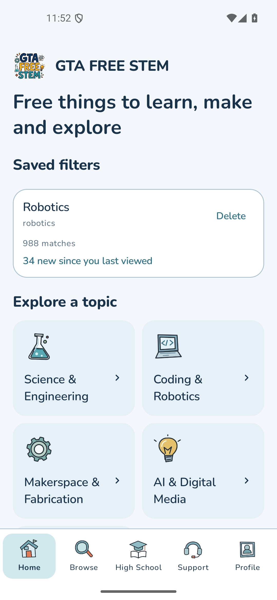
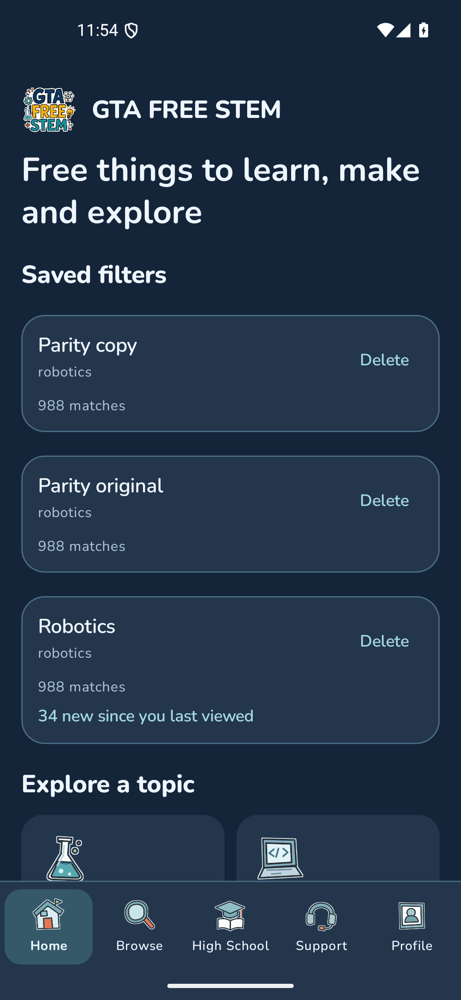
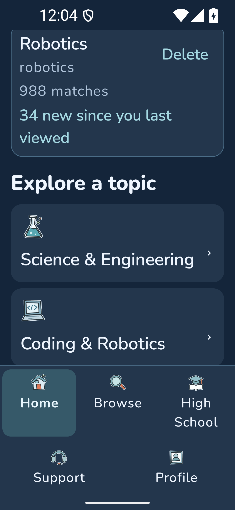
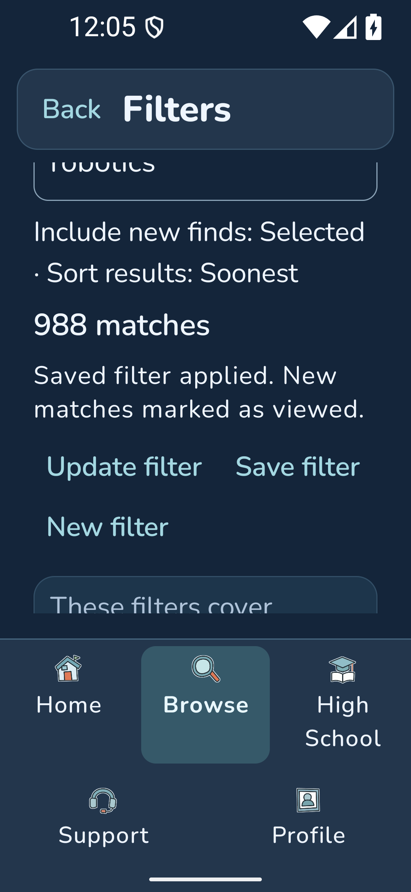
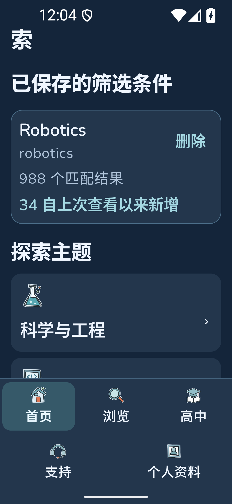
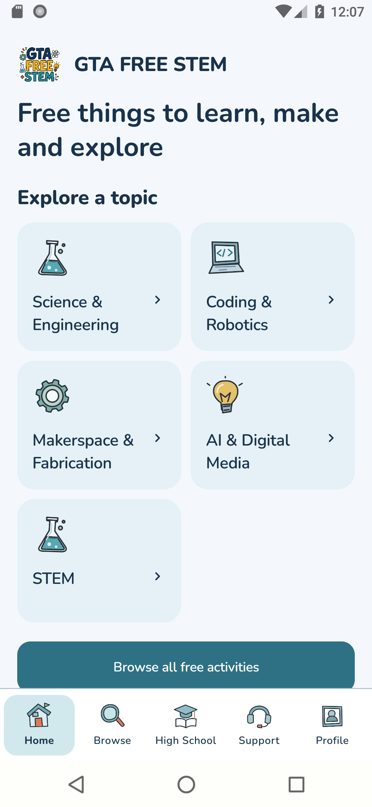

# Android parity with shipped iOS v3

This is native QA evidence for the scoped Home and content-control parity update. It does not claim tester availability or physical-phone acceptance. Runtime production source is `3ef86a033fe2f4c141028988bfaa5fac37ee6d79`; corrected test-only descendant is `dee36488ba84758c96bb3a90b20413cf9eb4ee76`. Coordinator packaging source `475ebcbdfce186b15fbfb67a7b245861956d44c2` changes metadata/strict verification to 7 / 1.1.2, with signing and Play delivery tracked separately.

## Changes

- Science & Engineering uses the flask, AI & Digital Media the bulb, and Library & Community the library. Existing approved artwork is reused.
- Home selects up to six available categories in the shipped iOS preference order. It never creates unavailable topics. Blue rounded topic tiles retain complete labels and use the existing RTL-aware internal chevron. Browse All follows the topics, including when saved filters exist.
- Content controls use 14dp corners, cards 20dp and topic tiles 18dp; dark muted text matches the iOS token. Nunito, the original logo/loader, and adaptive navigation/keyboard behavior are preserved.
- Save, Update and New stay inside Filters. Saving edited choices as a new preset remains available without overwriting the selected preset, so removing the redundant outer Save/Update row loses no action. No new model, timestamp or mark-read behavior is introduced.

## Verification

| Check | Fresh evidence |
| --- | --- |
| Unit suite | 248 passed, zero failures/errors/skips |
| Release lint and debug/test packages | Passed on final production source after the library-role correction |
| Modern Android | Initial 38-case run: 35 passed, three old MainActivity UI assumptions failed. Corrected test-only six-case class then passed; the 32 non-MainActivity cases used identical production bytes. Three of the initial 35 passes were MainActivity cases repeated in that correction run. This is not relabelled as one single 38/0 run. |
| Android 8 / API26 | Final full 38-case run passed, including the corrected MainActivity cases, artwork, large text, preset actions, discovery, account and saved-library flows |
| Actual preset transactions | Save as new preserved the original ID/query; reselect restored its query; explicit Update retained its ID; New detached without deleting the archive; normal relaunch showed both presets |
| Rendered states | Modern light/dark, maximum text, Arabic/Chinese, IME dismissal and zero-animation navigation; complete EN/ZH topic/action frames reviewed. API26 light Home/Browse/details/Filters frames retained. |

All owned emulator preference snapshots were restored bytewise, system settings/night mode restored, and each emulator shut down before the next workload. The coordinator requested immediate release after API26 passed; the optional extra older dark/max capture ended 130 after its finally restored settings. It remains explicitly incomplete. Physical-phone installation and journey remain unverified.

The original three test failures and both capture-helper failures are retained in [evidence](evidence). Their corrections did not weaken category, navigation, query persistence, panel or Back assertions. Full hashes, source lineage and limitations are in [qa-receipt.json](qa-receipt.json).

## Native review frames

